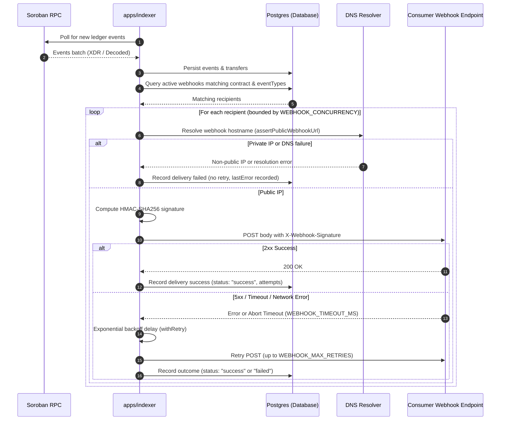

# Webhook Delivery Architecture & Guarantees

stellarlens delivers real-time notifications to external endpoints when smart contract events
land on the Stellar network. This document describes the delivery semantics, retry policies,
security controls, signature verification, and observability APIs.

---

## Architecture Overview



---

## Delivery Semantics

- **At-Least-Once Delivery**: The indexer prioritizes data delivery and resilience. While each event
  triggers a single delivery in normal operation, network hiccups, retries, indexer restarts, or
  cursor re-seeding can result in duplicate deliveries of the same event.
- **Idempotency**: Webhook consumers must ensure their endpoints are idempotent. You should track
  received event identifiers using `txHash` and `ledger`, or `eventId`.
- **Decoupled & Non-Blocking**: Webhook delivery is best-effort and decoupled from ingestion.
  Endpoint failures or delivery persistence errors will never stall blockchain indexing or rollback
  database event commits.

---

## Concurrency & Worker Pool

Outbound deliveries are processed through a concurrent worker pool bounded by `WEBHOOK_CONCURRENCY`:

- **Default limit**: `10` simultaneous deliveries per event batch.
- **Worker distribution**: Work is processed concurrently using `Promise.all` across available
  worker slots so slow or lagging recipient servers cannot exhaust memory or block other deliveries.
- **Tuning**: Configurable via the `WEBHOOK_CONCURRENCY` environment variable.

---

## Retry Schedule & Exponential Backoff

When an endpoint fails with a transient error (e.g., HTTP 5xx, network reset, or request timeout),
the indexer retries delivery using an exponential backoff strategy:

| Attempt   | Delay Formula       | Approximate Delay |
| :-------- | :------------------ | :---------------- |
| Attempt 1 | Immediate           | `0ms`             |
| Attempt 2 | `baseDelayMs * 2^0` | `500ms`           |
| Attempt 3 | `baseDelayMs * 2^1` | `1000ms`          |
| Attempt 4 | `baseDelayMs * 2^2` | `2000ms`          |

### Retry Parameters:

- **Max Retries (`WEBHOOK_MAX_RETRIES`)**: `3` (total of 4 attempts before declaring failure).
- **Base Delay (`WEBHOOK_RETRY_BASE_DELAY_MS`)**: `500ms`.
- **Max Delay Cap (`WEBHOOK_RETRY_MAX_DELAY_MS`)**: `5000ms` (`5s`).
- **Timeout (`WEBHOOK_TIMEOUT_MS`)**: `5000ms` (`5s`). An `AbortController` aborts requests exceeding
  this threshold, treating them as timeouts eligible for retry.

---

## Blocked Destinations & SSRF Protection

To guard against Server-Side Request Forgery (SSRF) and avoid wasting worker slots on broken targets,
every destination URL undergoes strict DNS and IP range validation via `assertPublicWebhookUrl`
prior to delivery:

### 1. Private & Reserved IP Blocking

All hostnames are resolved before sending. Deliveries are immediately rejected and aborted if the
IP address falls within non-public address spaces:

- IPv4 Loopback (`127.0.0.0/8`)
- RFC 1918 Private networks (`10.0.0.0/8`, `172.16.0.0/12`, `192.168.0.0/16`)
- Link-Local (`169.254.0.0/16`)
- Carrier-Grade NAT (`100.64.0.0/10`)
- Multicast & Future Use (`224.0.0.0/4`)
- IPv6 Unique-Local (`fc00::/7`), Link-Local (`fe80::/10`), and IPv4-mapped IPv6 ranges
- Documentation & benchmark subnets

### 2. DNS Failures (No-Retry Policy)

If DNS lookup fails (`ENOTFOUND`, `EAI_NONAME`, `ENODATA`, `EAI_FAIL`), or if the URL resolves to a
blocked private IP, the attempt throws `NonPublicWebhookUrlError` or resolution failure.

**These errors are never retried**. Retrying unresolvable hostnames or private IPs wastes resources,
so the delivery is immediately recorded as `failed` with the error reason saved to the database.

---

## Pausing, Filtering, and Active Status

Webhooks can be selectively filtered or paused at any time:

1. **Active Flag (`active`)**:
   - Each webhook record contains an `active` boolean (default: `true`).
   - If set to `false`, the indexer skips this endpoint completely during delivery selection.
   - Can be toggled via `PATCH /contracts/:contractId/webhooks/:id` or from the Webhook management UI.
2. **Topic Event Filtering (`eventTypes`)**:
   - Webhooks can optionally specify an array of event topics to listen to (e.g. `["transfer", "mint"]`).
   - If `eventTypes` is provided, deliveries only trigger if the event's primary topic (`topic[0]`) matches.
   - If `eventTypes` is empty or null, the webhook receives all events emitted by the contract.

---

## Signature Verification

Every webhook payload is signed with an HMAC-SHA256 signature generated with the secret key issued
at webhook registration. The signature is transmitted in the `X-Webhook-Signature` header:

```http
POST /your-webhook-endpoint HTTP/1.1
Host: your-domain.com
Content-Type: application/json
X-Webhook-Signature: sha256=d3b07384d113edec49eaa6238ad5ff00b1a0...
```

### Payload Structure

```json
{
  "eventId": 1042,
  "contractId": 12,
  "ledger": 54201,
  "txHash": "a1b2c3d4e5f6...",
  "topic": ["transfer", "CBF..."],
  "value": "10000000"
}
```

### Verifying with `@stellarlens/sdk`

The SDK provides `verifyWebhookSignature`, which executes in constant time using standard WebCrypto
(`crypto.subtle`) across Node.js 18+ and edge runtimes (Cloudflare Workers, Next.js Edge, Bun):

```ts
import { verifyWebhookSignature } from "@stellarlens/sdk";

// In your route handler:
const isValid = await verifyWebhookSignature({
  body: rawRequestBodyString,
  signatureHeader: req.headers["x-webhook-signature"],
  secret: process.env.STELLARLENS_WEBHOOK_SECRET!,
  toleranceSeconds: 300 // Replay protection window (defaults to 300s)
});

if (!isValid) {
  return res.status(400).send("Invalid signature");
}
```

---

## Delivery History & Observability API

All delivery attempts are recorded in the `webhook_deliveries` database table and exposed via the REST API:

### 1. Query Delivery History

`GET /contracts/:contractId/webhooks/:id/deliveries`

**Query Parameters:**

- `limit` (optional): Max results to return (1-100, default `20`).
- `cursor` (optional): Pagination cursor (delivery ID).

**Response:**

```json
{
  "data": [
    {
      "id": 502,
      "status": "success",
      "attempts": 1,
      "lastError": null,
      "deliveredAt": "2026-11-19T05:51:20.000Z",
      "createdAt": "2026-11-19T05:51:20.000Z"
    },
    {
      "id": 489,
      "status": "failed",
      "attempts": 4,
      "lastError": "webhook responded with status 503",
      "deliveredAt": null,
      "createdAt": "2026-11-19T05:48:10.000Z"
    }
  ],
  "nextCursor": 489
}
```

### 2. Secret Rotation

`POST /contracts/:contractId/webhooks/:id/rotate-secret`

Generates a fresh cryptographically random 32-byte hexadecimal secret key. The new secret takes
effect immediately for all subsequent event deliveries.

---

## Environment Variables Reference

| Variable                      | Default | Type             | Description                                                  |
| :---------------------------- | :------ | :--------------- | :----------------------------------------------------------- |
| `WEBHOOK_CONCURRENCY`         | `10`    | Positive integer | Maximum concurrent outbound webhook delivery requests        |
| `WEBHOOK_TIMEOUT_MS`          | `5000`  | Positive integer | Abort timeout (ms) for an individual webhook POST attempt    |
| `WEBHOOK_MAX_RETRIES`         | `3`     | Positive integer | Maximum retry attempts for transient delivery failures       |
| `WEBHOOK_RETRY_BASE_DELAY_MS` | `500`   | Positive integer | Initial delay (ms) for exponential backoff retry             |
| `WEBHOOK_RETRY_MAX_DELAY_MS`  | `5000`  | Positive integer | Maximum cap (ms) for exponential backoff delay               |
| `POLL_INTERVAL_MS`            | `5000`  | Positive integer | Soroban RPC polling interval in milliseconds                 |
| `POLL_ONCE`                   | `false` | Boolean          | Process a single poll batch and exit without starting daemon |
