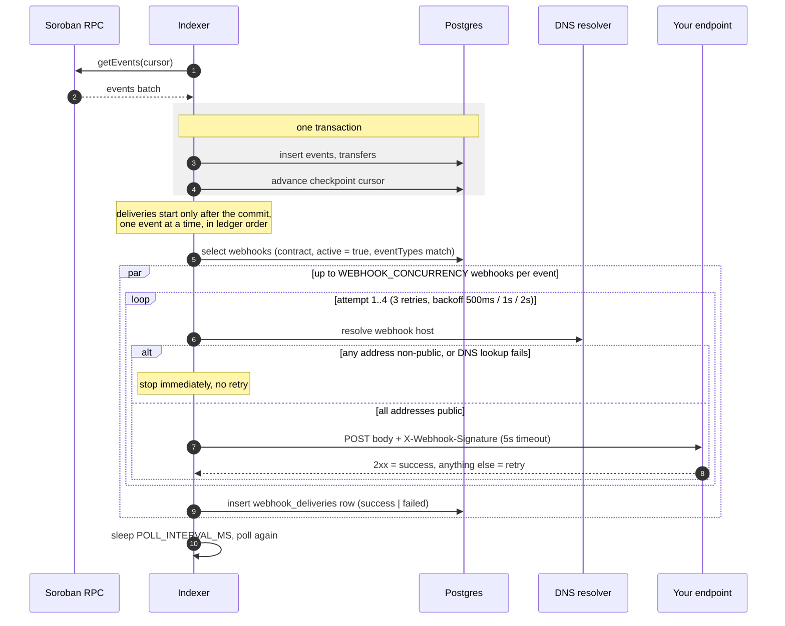

# Webhooks

stellarlens can POST every newly indexed event for a contract to URLs you register. This page is for
both **consumers** (people writing the endpoint that receives deliveries) and **operators** (people
running the indexer). It describes behaviour as implemented in
[`apps/indexer/src/webhooks.ts`](../apps/indexer/src/webhooks.ts),
[`apps/indexer/src/events.ts`](../apps/indexer/src/events.ts) and
[`apps/api/src/webhooks`](../apps/api/src/webhooks). If you change those files, update this page in
the same PR.

- [Lifecycle at a glance](#lifecycle-at-a-glance)
- [Managing webhooks](#managing-webhooks)
- [The request you receive](#the-request-you-receive)
- [Verifying signatures](#verifying-signatures)
- [Delivery semantics](#delivery-semantics)
- [Retry schedule](#retry-schedule)
- [Blocked destinations](#blocked-destinations)
- [Pausing a webhook](#pausing-a-webhook)
- [Delivery history api](#delivery-history-api)
- [Configuration](#configuration)

## Lifecycle at a glance



## Managing webhooks

All routes require an `x-api-key` header. Creating, updating, rotating and deleting are mutating
requests, so they need a `full`-scope key; a `read`-scope key gets `403`.

| Method & path | Body | Returns |
|---|---|---|
| `POST /contracts/:contractId/webhooks` | `{ "url": string, "eventTypes"?: string[] }` | The full webhook row, **including `secret`** — store it now |
| `GET /contracts/:contractId/webhooks` | — | `[{ id, url, eventTypes, createdAt }]` (no secret, no `active`) |
| `PATCH /contracts/:contractId/webhooks/:id` | `{ "url"?: string, "eventTypes"?: string[] }` | `{ id, contractId, url, eventTypes, createdAt }` |
| `POST /contracts/:contractId/webhooks/:id/rotate-secret` | — | The full webhook row with the **new** `secret` |
| `DELETE /contracts/:contractId/webhooks/:id` | — | `204`; the webhook's delivery history is deleted with it |
| `GET /contracts/:contractId/webhooks/:id/deliveries` | — | See [Delivery history api](#delivery-history-api) |

- `url` must be a syntactically valid URL (a TLD is not required, so `http://my-host:8080/hook`
  passes). It is **not** checked against the [blocked destinations](#blocked-destinations) at
  registration time, only on every delivery attempt.
- A contract can't have two webhooks with the same `url` (`409`).
- `eventTypes` filters on the event's first decoded topic (e.g. `"transfer"`). Omitted, `null` or `[]`
  means every event for the contract.
- The secret is 32 random bytes, hex-encoded (64 characters). Rotation takes effect from the next
  event the indexer delivers. Retries of an event already in flight keep the signature computed
  with the old secret. There's no overlap window, so update your endpoint's copy promptly.

## The request you receive

```http
POST /your/webhook/path HTTP/1.1
Content-Type: application/json
X-Webhook-Signature: sha256=<64 lowercase hex characters>
X-Webhook-Id: wh_<webhookId>_evt_<eventId>
X-Webhook-Event: transfer
X-Webhook-Attempt: 1

{"eventId":4182,"contractId":7,"ledger":512345,"txHash":"9f2c…","topic":["transfer","GABC…","GDEF…"],"value":"1000000"}
```

| Field | Type | Meaning |
|---|---|---|
| `eventId` | number | stellarlens' id for the event; unique and stable — **use it to deduplicate** |
| `contractId` | number | stellarlens' id for the registered contract (not the `C...` address) |
| `ledger` | number | Ledger sequence the event was emitted in |
| `txHash` | string | Transaction hash |
| `topic` | array | Decoded topic values (`scValToNative`); 64/128/256-bit integers are decimal strings |
| `value` | any | Decoded event value, same conversion rules as `topic` |

| Header | Meaning |
|---|---|
| `X-Webhook-Id` | Delivery id for this webhook/event pair; identical on every retry — **use it to deduplicate** |
| `X-Webhook-Event` | `topic[0]` when it is a string, otherwise `unknown` |
| `X-Webhook-Attempt` | `1` for the first attempt, incremented on each retry |

There is no timestamp header, and the body has no envelope or version
field. The raw XDR isn't included; fetch it from `GET /contracts/:contractId/events` if you need it.

Respond with any `2xx` status within **5 seconds**. The response body is ignored. Any other status, a
timeout, or a connection error counts as a failed attempt.

## Verifying signatures

`X-Webhook-Signature` is `sha256=` followed by the lowercase hex HMAC-SHA256 of the **raw request body
bytes**, keyed with the webhook's `secret` (used as a UTF-8 string, not hex-decoded). Compute it over
the bytes you received, before any JSON parsing or re-serialisation, and compare in constant time.

```ts
import { createHmac, timingSafeEqual } from "node:crypto";

export function verifySignature(rawBody: Buffer, header: string | undefined, secret: string): boolean {
  if (typeof header !== "string" || !header.startsWith("sha256=")) return false;
  const expected = Buffer.from(createHmac("sha256", secret).update(rawBody).digest("hex"), "utf8");
  const received = Buffer.from(header.slice("sha256=".length), "utf8");
  return expected.length === received.length && timingSafeEqual(expected, received);
}
```

```python
import hashlib, hmac

def verify_signature(raw_body: bytes, header: str | None, secret: str) -> bool:
    if not header or not header.startswith("sha256="):
        return False
    expected = hmac.new(secret.encode(), raw_body, hashlib.sha256).hexdigest()
    return hmac.compare_digest(expected, header[len("sha256="):])
```

The signature covers only the body. It contains no timestamp, so it does not by itself prevent
replay; deduplicating on `eventId` makes a replayed request harmless.

## Delivery semantics

**Short version: each event is delivered at most once per webhook *as a unit of work* (it's never
re-queued), but a single delivery can reach your endpoint more than once (at least once *per
attempt that might have succeeded*). Make your handler idempotent on `eventId`, and treat gaps as
possible.**

In detail:

- **No redelivery after a crash: at-most-once across failures.** The indexer commits the batch's
  events *and* advances its checkpoint in one transaction, then delivers webhooks. If the process
  stops after the commit but before or during delivery, those events are never sent: there is no
  outbox and no replay. The same applies when every attempt fails: the outcome is recorded as
  `failed` and the event is not retried later.
- **Duplicates are possible: at-least-once within the retry window.** If your endpoint processes
  the request but responds slowly (over 5s) or with a non-`2xx` status, the indexer retries and you
  receive the same body (same `eventId`, same signature) again, up to 4 times in total.
- **Ordering.** Events are delivered one at a time, in the order the RPC returned them (ledger order),
  and the next event's deliveries start only after every webhook has finished with the current one
  (including retries). In normal operation a given webhook therefore sees events in order. Retries
  happen before the next event is sent, never after.
- **Fan-out.** For a single event, up to `WEBHOOK_CONCURRENCY` webhooks are delivered to in parallel.
  A slow endpoint delays the *next event* for every webhook, and the next poll cycle, by up to
  ~23.5s (4 × 5s timeouts + 3.5s of backoff).
- **Isolation.** Delivery failures (including failing to load webhooks or to record a delivery row)
  are logged and swallowed. They never fail the indexing batch or roll back indexed data.
- **Paused webhooks and non-matching `eventTypes`** are skipped entirely: no request, no delivery row.

## Retry schedule

Constants live in [`apps/indexer/src/config.ts`](../apps/indexer/src/config.ts) and aren't
configurable through env vars.

| Attempt | Waits before attempt | Timeout | Cumulative worst case |
|---|---|---|---|
| 1 | — | 5s | 5s |
| 2 | 500ms | 5s | 10.5s |
| 3 | 1s | 5s | 16.5s |
| 4 | 2s | 5s | 23.5s |

Backoff is `min(500ms × 2^(retry − 1), 5s)` with no jitter (`WEBHOOK_MAX_RETRIES = 3`,
`WEBHOOK_RETRY_BASE_DELAY_MS = 500`, `WEBHOOK_RETRY_MAX_DELAY_MS = 5000`, `WEBHOOK_TIMEOUT_MS = 5000`).

These failures stop immediately, with no retries (`attempts` is `1`):

- **DNS resolution failure.** The host doesn't resolve (`ENOTFOUND`, `EAI_NONAME`, `ENODATA`,
  `EAI_FAIL`, including when wrapped as the `cause` of a fetch error). Recorded as
  `lastError: "DNS resolution failed for <url>: <message>"` and logged as unreachable.
- **Blocked destination.** The host resolves to a non-public address (see below). Recorded as
  `lastError: "webhook URL resolves to a non-public IP address"`.
- **Redirect.** The endpoint answers with a `3xx`. Redirects are never followed; recorded as
  `lastError: "webhook responded with redirect status 302 to <location>; redirects are not followed"`.

Everything else is retried: non-`2xx` (`"webhook responded with status 503"`), timeouts, connection
refused/reset, TLS errors.

## Blocked destinations

To keep the indexer from being used to reach internal services (SSRF), every attempt first resolves
the URL's host (all `A`/`AAAA` records) and refuses to send if **any** address is non-public, or if
there are none. IP-literal hosts are checked directly.

Blocked IPv4 ranges:

| Range | Why |
|---|---|
| `0.0.0.0/8` | "This network" |
| `10.0.0.0/8`, `172.16.0.0/12`, `192.168.0.0/16` | Private networks |
| `100.64.0.0/10` | Carrier-grade NAT |
| `127.0.0.0/8` | Loopback |
| `169.254.0.0/16` | Link-local, including cloud metadata endpoints (`169.254.169.254`) |
| `192.0.0.0/16` | IETF protocol assignments and TEST-NET-1 (note: the whole `/16` is blocked) |
| `192.88.99.0/24` | 6to4 relay anycast |
| `198.18.0.0/15` | Benchmarking |
| `198.51.100.0/24`, `203.0.113.0/24` | Documentation (TEST-NET-2/3) |
| `224.0.0.0/3` | Multicast, reserved, and broadcast (`224.0.0.0` and above) |

IPv6: only global unicast (`2000::/3`) is allowed, minus documentation (`2001:db8::/32`), the IETF
special-purpose block (`2001::/23`, including Teredo) and 6to4 (`2002::/16`). Loopback (`::1`),
unique-local (`fc00::/7`), link-local (`fe80::/10`) and multicast are therefore blocked.
IPv4-mapped addresses (`::ffff:a.b.c.d`) are checked against the IPv4 rules.

Known limits, for operators assessing the protection:

- The HTTP connection uses its own DNS lookup that re-checks every resolved address and connects
  only to a validated public one, so a DNS-rebinding host can't switch to a private address after
  the check. TLS SNI and the `Host` header still use the configured hostname.
- HTTP redirects are not followed (`redirect: "manual"`), so a public endpoint can't bounce the
  signed request to an internal address; any `3xx` is recorded as a failed delivery.
- Registration doesn't check the destination, so a webhook pointing at a blocked address can be
  created; every delivery to it is then recorded as `failed`.

For local development against an endpoint on your own machine, expose it through a public tunnel.
There is no allow-list override.

## Pausing a webhook

Each webhook has an `active` flag (default `true`). The indexer only loads webhooks with
`active = true`, so while a webhook is paused, events are **skipped, not queued**: unpausing
doesn't backfill what was missed, and no delivery rows are written for skipped events. The change
takes effect from the next event the indexer processes, with no restart needed.

The api doesn't expose `active` yet. `PATCH` accepts only `url` and `eventTypes`, and unknown fields
are stripped, so sending `"active": false` is silently ignored. Until it does, operators toggle it in
the database:

```sql
UPDATE webhooks SET active = false WHERE id = 42;  -- pause
UPDATE webhooks SET active = true  WHERE id = 42;  -- resume
```

To stop deliveries permanently, `DELETE` the webhook. That also removes its delivery history.

## Delivery history api

Every delivery that reaches a final outcome writes one row to `webhook_deliveries`: one row per
webhook per event, written after the last attempt, not one per attempt.

```http
GET /contracts/:contractId/webhooks/:id/deliveries?limit=20&cursor=123
x-api-key: <key>
```

| Query param | Default | Notes |
|---|---|---|
| `limit` | `20` | `1`–`100` |
| `cursor` | — | Pass the previous page's `nextCursor`; returns deliveries with `id` < cursor |

```json
{
  "data": [
    {
      "id": 125,
      "idempotencyKey": "wh_12_evt_4183",
      "status": "failed",
      "attempts": 4,
      "lastError": "webhook responded with status 503",
      "deliveredAt": null,
      "createdAt": "2026-11-19T10:02:11.481Z"
    },
    {
      "id": 124,
      "idempotencyKey": "wh_12_evt_4182",
      "status": "success",
      "attempts": 1,
      "lastError": null,
      "deliveredAt": "2026-11-19T10:01:59.006Z",
      "createdAt": "2026-11-19T10:01:59.010Z"
    }
  ],
  "nextCursor": 124
}
```

- Newest first. `nextCursor` is `null` on the last page.
- `status` is `"success"` or `"failed"`. `attempts` counts HTTP attempts, including the final one.
  `deliveredAt` is set only on success.
- The response doesn't include the event id. Rows are in the same order as events were delivered,
  and `webhook_deliveries.event_id` is in the database if you need to join.
- `404` if the webhook doesn't belong to that contract.
- History is best-effort: if writing the row fails, the indexer logs
  `webhook <id> delivery outcome could not be persisted` and carries on. A missing row doesn't
  mean nothing was sent.
- Rows are deleted with their webhook or their event (`ON DELETE CASCADE`). There's no other
  retention limit.

## Configuration

Indexer env vars that affect webhooks:

| Variable | Default | Effect |
|---|---|---|
| `WEBHOOK_CONCURRENCY` | `10` | Max webhooks delivered to in parallel **for one event**. Must be a positive integer; the indexer refuses to start otherwise. Events themselves are always delivered one at a time. |
| `POLL_INTERVAL_MS` | `5000` | Sleep between poll cycles. Together with delivery time, sets how quickly new events reach endpoints. |
| `POLL_ONCE` | `false` | `true` runs one poll cycle (deliveries included) and exits. |
| `DATABASE_URL` | — | Where webhooks are read from and delivery history is written. |
| `SOROBAN_RPC_URL`, `STELLAR_NETWORK` | — | Required by the indexer; only events from that network are indexed and delivered. |

Retry counts, backoff and the 5s request timeout are code constants (see [Retry schedule](#retry-schedule)).
The api has no webhook-specific settings.
